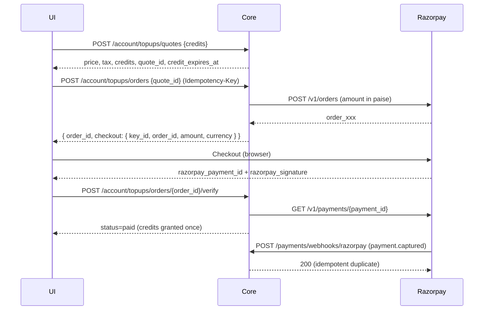

# Razorpay Credit Top-up — Backend Integration

> Note: `RAZORPAY_TOPUP_BACKEND_INTEGRATION.md` currently contains RFQ notes by
> mistake. This file is the Razorpay/top-up contract.

This implements the server side of the credit top-up flow described in
`SUBSCRIPTION_PLAN_API_IMPLEMENTATION.md` §5.4/§5.6.



## 1. Environment variables (core-service)

| Variable | Required | Meaning |
| --- | --- | --- |
| `RAZORPAY_KEY_ID` | yes | Public checkout key (`rzp_live_…` / `rzp_test_…`) |
| `RAZORPAY_KEY_SECRET` | yes | API secret; also signs the Checkout callback |
| `RAZORPAY_WEBHOOK_SECRET` | yes for webhooks | Secret configured on the Razorpay webhook |
| `RAZORPAY_CURRENCY` | no (default `INR`) | Order currency; should match plan currency |
| `RAZORPAY_COMPANY_NAME` | no | Name shown in Checkout |
| `RAZORPAY_TIMEOUT_SECONDS` | no (default `10`) | HTTP timeout to Razorpay |

If the key pair is empty, `POST /account/topups/orders` returns
`503 PAYMENT_PROVIDER_NOT_CONFIGURED` — no fake/sandbox grants are ever made.

## 2. Endpoints

| Method | Path | Auth | Purpose |
| --- | --- | --- | --- |
| POST | `/api/v1/account/topups/quotes` | `billing.topup` (or fallbacks) | Price/tax/credits/expiry quote |
| POST | `/api/v1/account/topups/orders` | same + `Idempotency-Key` | Create local order + Razorpay order |
| POST | `/api/v1/account/topups/orders/{order_id}/verify` | same | Verify Checkout callback, grant credits |
| GET | `/api/v1/account/topups/orders/{order_id}` | same | Poll status (`pending` / `paid` / `failed`) |
| POST | `/api/v1/payments/webhooks/razorpay` | signature only | Webhook settle (deduped) |
| GET | `/api/v1/account/credits` | `subscription.read` | New authoritative balance |

### 2.1 Quote

```http
POST /api/v1/account/topups/quotes
Content-Type: application/json

{ "credits": "1000" }
```

```json
{
  "quote_id": "…",
  "credits": "1000.000000",
  "subtotal": "100.00",
  "tax_amount": "18.00",
  "total": "118.00",
  "currency": "INR",
  "expires_at": "2026-10-20T10:15:00Z",
  "credit_expires_at": "2027-10-20T10:00:00Z"
}
```

Unit price is `plan_version.base_price / plan_version.included_credits`
(fallback `0.05`). Quotes expire after 15 minutes and are single-use.

### 2.2 Create order

```http
POST /api/v1/account/topups/orders
Idempotency-Key: 8f3c…
Content-Type: application/json

{ "quote_id": "…", "provider": "razorpay" }
```

`provider` defaults to `razorpay`. Response:

```json
{
  "order_id": "9d2e…",
  "status": "pending",
  "checkout_url": null,
  "amount": "118.00",
  "currency": "INR",
  "credits": "1000.000000",
  "provider": "razorpay",
  "provider_order_id": "order_Pxxxx",
  "provider_payment_id": null,
  "checkout": {
    "provider": "razorpay",
    "key_id": "rzp_test_…",
    "order_id": "order_Pxxxx",
    "amount": 11800,
    "currency": "INR",
    "name": "Ciphercode",
    "description": "1000.000000 QR credits",
    "prefill": { "email": "user@example.com" }
  }
}
```

`checkout.amount` is in **paise** (integer). Retrying with the same
`Idempotency-Key` returns the same local order; no second Razorpay order is
created. If Razorpay rejects/cannot be reached the local order is marked
`failed` and the API returns `502 PAYMENT_PROVIDER_ERROR` /
`PAYMENT_PROVIDER_UNAVAILABLE`.

### 2.3 Verify Checkout callback

```http
POST /api/v1/account/topups/orders/{order_id}/verify
Content-Type: application/json

{
  "razorpay_order_id": "order_Pxxxx",
  "razorpay_payment_id": "pay_Pyyyy",
  "razorpay_signature": "…"
}
```

Server behaviour:

1. `HMAC_SHA256(order_id|payment_id, RAZORPAY_KEY_SECRET)` must match
   `razorpay_signature` → otherwise `400 SIGNATURE_INVALID`.
2. Orders whose `provider_ref` differs → `422 ORDER_MISMATCH`.
3. Re-fetches the payment from Razorpay; requires `status=captured`, matching
   order id, amount and currency → otherwise `422 PAYMENT_MISMATCH`.
4. Grants exactly one `topup` credit batch, keyed to `(organization, topup_order)`
   so both this call and the webhook are idempotent.

If Razorpay returns `authorized` but not captured, the API returns
`402 PAYMENT_NOT_CAPTURED`; rely on the `payment.captured` webhook.

### 2.4 Webhook

Configure in Razorpay Dashboard → Settings → Webhooks:

- URL: `https://<core-host>/api/v1/payments/webhooks/razorpay`
- Secret: same value as `RAZORPAY_WEBHOOK_SECRET`
- Events: `payment.captured`, `order.paid`

Behaviour:

- Verifies `X-Razorpay-Signature` (HMAC-SHA256 of the raw body) → `400` if bad.
- Deduplicates on `X-Razorpay-Event-Id` in `billing_provider_events`; a repeat
  returns `{"status":"duplicate"}` with HTTP 200.
- Finds the order by Razorpay order id (`topup_orders.provider_ref`), compares
  amount/currency, re-fetches the payment server-side, then grants once.
- Unknown orders return HTTP 200 `{"status":"ignored","reason":"unknown_order"}`
  (logged) so Razorpay does not retry forever.
- On a processing error the event row is rolled back and a non-2xx is returned,
  so Razorpay retries the same event id.

## 3. Frontend integration (Razorpay Checkout)

```ts
// 1) quote
const quote = await api.post('/account/topups/quotes', { credits });

// 2) order (idempotency key per attempt)
const order = await api.post(
  '/account/topups/orders',
  { quote_id: quote.quote_id, provider: 'razorpay' },
  { headers: { 'Idempotency-Key': crypto.randomUUID() } }
);

// 3) checkout
const rzp = new (window as any).Razorpay({
  ...order.checkout,
  method: { upi: true, card: true, netbanking: true, wallet: true },
  handler: async (response: any) => {
    const paid = await api.post(
      `/account/topups/orders/${order.order_id}/verify`,
      {
        razorpay_order_id: response.razorpay_order_id,
        razorpay_payment_id: response.razorpay_payment_id,
        razorpay_signature: response.razorpay_signature,
      }
    );
    if (paid.status === 'paid') refreshCredits();
  },
  modal: {
    ondismiss: () => pollOrder(order.order_id), // webhook may still settle
  },
});
rzp.open();

// 4) fallback polling when the callback is missed
async function pollOrder(orderId: string) {
  for (let i = 0; i < 30; i++) {
    const o = await api.get(`/account/topups/orders/${orderId}`);
    if (o.status === 'paid') return refreshCredits();
    await new Promise((r) => setTimeout(r, 2000));
  }
}
```

Rules:

- Never grant credits on the browser redirect — only `/verify` or the webhook,
  both of which verify signatures and re-fetch the payment.
- Always show `credit_expires_at` (from the quote) before opening Checkout.
- Disable the pay button while an order is `pending`; retry with a **new**
  idempotency key only after a failed order.

## 4. Error codes

| HTTP | Code | Meaning |
| --- | --- | --- |
| 400 | `INVALID_QUOTE` | Quote expired or already used |
| 400 | `SIGNATURE_INVALID` | Checkout/webhook signature mismatch |
| 402 | `PAYMENT_NOT_CAPTURED` | Payment authorized but not captured yet |
| 409 | `TOPUP_NOT_ALLOWED` | Subscription suspended or plan disallows top-ups |
| 409 | `PROVIDER_MISMATCH` | Order was not created with Razorpay |
| 422 | `CURRENCY_NOT_SUPPORTED` | Plan currency ≠ `RAZORPAY_CURRENCY` |
| 422 | `ORDER_MISMATCH` | Razorpay order id ≠ local order |
| 422 | `PAYMENT_MISMATCH` | Amount/currency/order mismatch |
| 502 | `PAYMENT_PROVIDER_ERROR` | Razorpay rejected the request |
| 502 | `PAYMENT_PROVIDER_UNAVAILABLE` | Razorpay unreachable |
| 503 | `PAYMENT_PROVIDER_NOT_CONFIGURED` | Keys not set |
| 503 | `WEBHOOK_NOT_CONFIGURED` | Webhook secret not set |

## 5. Which credit balance should the app use?

**Use the new system.** `credit_batches` + `credit_ledger` is the source of
truth; `qr_credit_balance` is legacy.

| | New (`credit_batches` / `credit_ledger`) | Old (`qr_credit_balance`) |
| --- | --- | --- |
| Read API | `GET /api/v1/account/credits` | `GET /api/v1/qr-credits/balance` |
| Batch history | `GET /account/credits/batches` | none |
| Expiry / FEFO | yes | no — single bucket |
| Weighted debit | yes (`id_weight`, 6dp) | integer credits only |
| Top-ups / plan grants | yes | **not updated** |
| Generation enforcement | `/internal/credits/reserve|commit|release` | `CreditService` (block-level) |
| Rebuildable | yes (append-only ledger) | no |

Do **not** display or reconcile against both — pick the new one. Suggested
migration:

1. Apply migrations `136_subscription_billing` and
   `137_topup_provider_payment_id`.
2. Backfill legacy balances once:
   `PYTHONPATH=. ./.venv/bin/python scripts/backfill_legacy_qr_credits.py --apply`
   (creates one `legacy_balance` batch per org; idempotent).
3. Switch the dashboard credits widget to `GET /account/credits`
   (and `/account/credits/batches`, `/account/credits/ledger`).
4. Point QR generation at `POST /internal/credits/rate|reserve|commit|release`
   instead of `CreditService.reserve_credits/consume_reserved_credits`.
5. Remove `/qr-credits/balance` usage (keep the route temporarily for
   compatibility; it is not fed by top-ups or plan grants).

**Important:** until step 4 lands, top-ups and plan grants increase the new
balance only. If the QR generation flow still reads `qr_credit_balance`, the
two will diverge. Either complete step 4 or add a temporary dual-write bridge —
the new engine is the recommended target.

## 6. Test checklist

- [ ] Quote → order returns a Razorpay `checkout` payload with a non-empty
      `key_id` and paise amount.
- [ ] Replaying the same `Idempotency-Key` does not create a second order.
- [ ] Correct checkout signature → `paid` and exactly one batch.
- [ ] Bad signature / amount mismatch → rejected, no batch.
- [ ] Duplicate webhook event id → `duplicate`, no second batch.
- [ ] Unknown Razorpay order → ignored with HTTP 200.
- [ ] `GET /account/credits` reflects the new batch; the old
      `qr-credit` balance is untouched.
