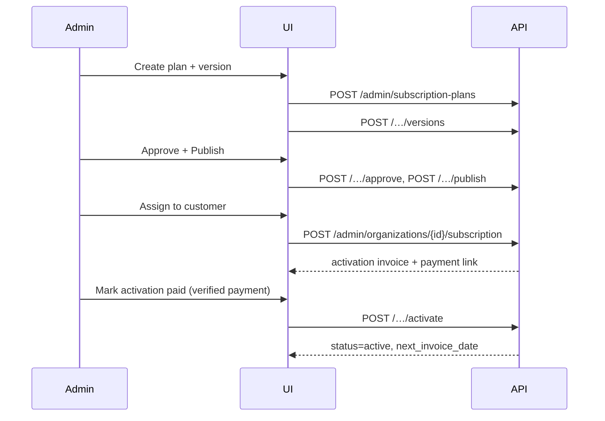

# Subscription & Billing — Admin UI Integration Guide

Frontend handoff for the **Ciphercode Operations / Finance console**. Covers the
plan catalog, tenant subscription lifecycle, activation/payment state, credit
adjustments, exposure and reconciliation screens. API contracts are defined in
`SUBSCRIPTION_PLAN_API_IMPLEMENTATION.md`; this document is about consuming them.

| Item         | Value                                                                         |
| ------------ | ----------------------------------------------------------------------------- |
| Backend      | Core Service `http://localhost:8001/api/v1` (prod: gateway host)              |
| Auth         | `Authorization: Bearer <admin JWT>`                                           |
| Content type | `application/json`; all decimals are **strings**                              |
| Currency     | ISO-4217 on every money field; never assume `USD`                             |
| Timestamps   | ISO-8601 UTC (`2026-11-01T00:00:00Z`); render in the org's `billing_timezone` |

---

## 1. Access model

| Screen group                 | Required permission                                           | Notes                                                  |
| ---------------------------- | ------------------------------------------------------------- | ------------------------------------------------------ |
| Plan catalog (read)          | `system_admin.billing_read`                                   | Ops + Finance + support lead                           |
| Plan catalog (write/publish) | `system_admin.billing_create` / `system_admin.billing_update` | Publish shows a confirmation dialog                    |
| Tenant subscription (read)   | `system_admin.billing_read`                                   |                                                        |
| Tenant subscription (mutate) | `system_admin.billing_update`                                 | Suspend/close require a reason                         |
| Payment reconciliation       | `system_admin.billing_read`                                   | Export allowed                                         |
| Credit adjustments           | `system_admin.billing_update`                                 | Above threshold requires `approval_id` (dual approval) |

Hide (do not merely disable) write actions the current user cannot perform: call
`GET /admin/permissions` (existing) or read the JWT permission claim once and
cache it for the session.

---

## 2. Navigation / information architecture

```text
Billing
├── Overview                 → GET /admin/billing/summary (existing)
├── Plans
│   ├── Plan list            → GET /admin/subscription-plans
│   └── Plan detail          → GET /admin/subscription-plans/{plan_id}
│       ├── Versions (draft / approved / published / retired)
│       └── Version editor   (draft only)
├── Customers
│   └── Customer subscription → GET /admin/organizations/{org_id}/subscription
├── Credits
│   ├── Exposure             → GET /admin/subscriptions/exposure
│   └── Adjustments          → POST /admin/credits/adjustments
└── Reconciliation           → GET /admin/subscriptions/reconciliation
```

Existing screens (invoice creation, billing summary, credit balance/ledger under
`/admin/billing/*` and `/qr-credits/organizations/{id}`) stay in place.

---

## 3. Screen: Plan list

**Route:** `/admin/billing/plans`

**Data:** `GET /admin/subscription-plans?active=true&page=1&page_size=25&q=`

```json
{
  "items": [
    {
      "id": "…",
      "code": "ENT-GROWTH",
      "name": "Enterprise Growth",
      "organization_id": "b0e1…",
      "organization_name": "Acme FZE",
      "currency": "USD",
      "is_active": true,
      "published_version": {
        "version": 3,
        "billing_cadence": "annually",
        "base_price": "12000.00",
        "included_credits": "120000.000000",
        "id_weight": "0.500000",
        "effective_from": "2026-11-01T00:00:00Z"
      },
      "draft_version_count": 1
    }
  ],
  "pagination": {
    "page": 1,
    "page_size": 25,
    "total_items": 12,
    "total_pages": 1
  }
}
```

**Columns:** Code · Name · Scope (Global / Org name) · Cadence · Base price ·
Included credits · ID weight · Published version · Effective from · Status ·
Actions.

**Filters:** search (`q` matches code/name), scope (`organization_id`),
`active`, cadence.

**Row actions:** View · Create version · New subscription (deep-links to the
customer subscription screen with `?plan_id=…`).

**States:** skeleton rows while loading; empty state offers _Create plan_; 403 →
permission notice; retry button on 5xx.

---

## 4. Screen: Plan detail & version editor

**Route:** `/admin/billing/plans/:planId`

`GET /admin/subscription-plans/{plan_id}` returns the plan plus `versions[]`
(newest first) with `status`, `effective_from/to`, `approved_by`, `created_at`.

### 4.1 Version timeline

Render as a vertical list (not a table) because published versions are immutable:

- **draft** — editable; shows _Approve_ and _Publish_.
- **approved** — read-only; shows _Publish_ (approver recorded).
- **published** — read-only badge; _Retire_ action (sets `effective_to`).
- **retired** — read-only.

### 4.2 Version form (draft only)

`POST /admin/subscription-plans/{plan_id}/versions` (create) or
`PATCH /admin/subscription-plans/{plan_id}/versions/{version_id}` (edit).

| Field              | Control                                 | Validation                                    |
| ------------------ | --------------------------------------- | --------------------------------------------- |
| `billing_cadence`  | select `monthly / quarterly / annually` | required                                      |
| `base_price`       | money input, 2dp                        | `>= 0`; send as string                        |
| `tax_rate`         | percent input, 4dp                      | `0–100`; send as string (e.g. `"7.5000"`)     |
| `included_credits` | decimal input, up to 6dp                | `>= 0`                                        |
| `id_weight`        | decimal input, up to 6dp                | `> 0`; show helper "credits per generated ID" |
| `topup_allowed`    | toggle                                  | default on                                    |
| `effective_from`   | date-time picker (org timezone)         | must be > now for publish                     |

Client-side guardrails:

- Show a computed example: `100 IDs × 0.5 = 50 credits`.
- When `billing_cadence` changes on an existing plan, warn that current
  subscriptions keep their contract version until re-assigned.
- Disable _Publish_ until `approval_id` exists (approve first) and
  `effective_from` is valid.

### 4.3 Publish confirmation

Dialog must state: "Published versions are immutable and affect only
subscriptions assigned this version from `effective_from`. Existing invoices and
prior usage are not recalculated." Require typing the plan code to confirm for
finance-sensitive accounts.

**Error mapping**

| Code                       | UI message                                                                          |
| -------------------------- | ----------------------------------------------------------------------------------- |
| `VERSION_NOT_DRAFT`        | "This version was published or retired. Create a new version."                      |
| `EFFECTIVE_RANGE_OVERLAP`  | Highlight `effective_from`; "Another published version already covers this period." |
| `ID_WEIGHT_INVALID`        | Inline error under the weight field                                                 |
| `409 IDEMPOTENCY_CONFLICT` | "This change was already submitted with different values. Reload."                  |

---

## 5. Screen: Customer subscription

**Route:** `/admin/customers/:orgId/subscription`
**Deep link:** `/admin/customers/:orgId/subscription?plan_id=…&version_id=…`

### 5.1 Header card

`GET /admin/organizations/{org_id}/subscription` — fields per §5.2 of the API
guide. Render:

- Status pill (`draft`, `pending_activation_payment`, `active`, `overdue`,
  `suspended`, `closed`) with the same colour scale used elsewhere in the admin
  console.
- Plan name + version + effective range.
- Currency, base price, included credits per period, current ID weight.
- Activation fee + `activation_fee_status`.
- Current period, next invoice date, billing anchor day/timezone.
- Primary action depends on status:
  - `draft` → _Assign plan_ (only if no version yet)
  - `pending_activation_payment` → _Mark activation paid_ (opens payment
    verification dialog; never a free-text "paid" toggle)
  - `active` → _Change version_, _Suspend_
  - `overdue` → _Record payment_, _Suspend_
  - `suspended` → _Reinstate_, _Close_

### 5.2 Create subscription

```http
POST /api/v1/admin/organizations/{org_id}/subscription
Idempotency-Key: <uuid>
```

```json
{
  "plan_version_id": "…",
  "billing_anchor_day": 1,
  "billing_timezone": "Africa/Lagos",
  "activation_fee": "2500.00",
  "activation_fee_required": true
}
```

Validation: only `published` versions are selectable; `billing_anchor_day` 1–28;
timezone via IANA list. On success, show the activation invoice number and a
copyable payment link when the API returns one.

### 5.3 Change version (effective-dated)

`PATCH /admin/organizations/{org_id}/subscription`

```json
{
  "plan_version_id": "…",
  "effective_from": "2026-12-01T00:00:00Z",
  "reason": "Signed annual renewal"
}
```

The UI must display a before/after diff of price, credits and weight and warn:
"Usage before `effective_from` keeps its original weight." Show the effective
date on the header card once saved.

### 5.4 Suspend / reinstate / close

All three require `reason` (min 10 chars) and render in the audit trail.
`close` is destructive — require typed org slug confirmation.

### 5.5 Credits panel (same screen)

- `GET /qr-credits/organizations/{org_id}` → available/reserved/used totals.
- `GET /qr-credits/organizations/{org_id}/ledger?page=1&page_size=20` →
  paginated ledger (`transaction_type`, `amount`, `balance_after`, `reason`,
  `created_at`, `created_by`).
- Batch list (`GET /admin/organizations/{org_id}/credits/batches`) with
  `expires_at`, remaining quantity, source invoice/top-up.

**Adjustment dialog** → `POST /admin/credits/adjustments`:

| Field     | Rule                                                        |
| --------- | ----------------------------------------------------------- |
| Direction | `adjust_positive` / `adjust_negative`                       |
| Quantity  | `> 0`; show resulting balance before submit                 |
| Expiry    | required for positive; default +12 months                   |
| Reason    | required, min 10 chars                                      |
| Approval  | required above org threshold; picker over pending approvals |

Negative adjustments that would go below zero must be blocked client-side _and_
will return `422 INSUFFICIENT_BALANCE`.

---

## 6. Screen: Credit exposure

**Route:** `/admin/billing/credits/exposure`

`GET /admin/subscriptions/exposure?expiring_within_days=30&page=1`

```json
{
  "items": [
    {
      "organization_id": "…",
      "organization_name": "Acme FZE",
      "subscription_status": "active",
      "available": "1950.000000",
      "reserved": "0.000000",
      "expiring_30_days": "750.000000",
      "earliest_expiry": "2027-01-01T00:00:00Z",
      "overdue_invoices": 1,
      "outstanding_amount": "12000.00"
    }
  ],
  "totals": {
    "organizations": 34,
    "available": "812000.000000",
    "expiring_30_days": "24500.000000"
  }
}
```

Table supports sort by `available`, `earliest_expiry`, `outstanding_amount`;
filters by subscription status and expiry window. Row click opens the customer
subscription screen.

---

## 7. Screen: Reconciliation

**Route:** `/admin/billing/reconciliation`

`GET /admin/subscriptions/reconciliation?from=&to=`

Rows are _findings_, not invoices:

| `issue`                      | Meaning                                 | Suggested action                            |
| ---------------------------- | --------------------------------------- | ------------------------------------------- |
| `paid_invoice_without_grant` | Invoice `paid`, no `credit_batches` row | Open customer → grants tab → re-run webhook |
| `grant_without_payment`      | Batch exists, no settled payment        | Investigate; never delete                   |
| `batch_sum_mismatch`         | Projection ≠ sum of batches             | "Rebuild projection" (permission gated)     |
| `duplicate_grant`            | Two batches for one invoice             | Alert only; finance review                  |
| `stuck_reservation`          | `reserved_until` passed                 | Release reservation                         |
| `expired_batch_consumed`     | Ledger consume after `expires_at`       | Alert only                                  |

Each row exposes the referenced IDs and a copyable audit link
(`/admin/audit-logs?entity=…`). Provide CSV export of the current filter.

---

## 8. Shared frontend pieces

- `useIdempotencyKey()` — generates a UUID per form submission attempt and reuses
  it on retry of the _same_ payload.
- `<Money value currency />` — renders API strings without `parseFloat` math.
- `<CreditQuantity value />` — 6dp source, displays max 2dp, tooltip full value.
- `<StatusPill status />` — statuses are snake_case exactly as returned.
- `<EffectiveDateWarning />` — for all date-effective edits.
- API client must treat `402` and `409` as domain errors with actionable
  messages, not generic toasts.

Caching/invalidation:

- Invalidate plan list after create/publish/retire.
- Invalidate customer subscription + credits after any mutate.
- Do not cache `/admin/billing/summary` longer than 60 s.

---

## 9. End-to-end admin flow



---

## 10. Acceptance checklist for the admin UI

- [ ] Plan list and detail honour `system_admin.billing_*` permissions.
- [ ] Published versions cannot be edited; only drafts accept `PATCH`.
- [ ] Publish dialog blocks invalid/overlapping effective dates.
- [ ] Customer subscription screen renders every status with the correct actions.
- [ ] Activation-paid action is only reachable through verified payment details.
- [ ] Version change shows a before/after diff and an effective date.
- [ ] Credit adjustment enforces reason, expiry, approval threshold and balance.
- [ ] Exposure and reconciliation screens export CSV and deep-link to records.
- [ ] All decimals rendered from strings; no float rounding in the UI.
- [ ] Retries reuse the same `Idempotency-Key`.
