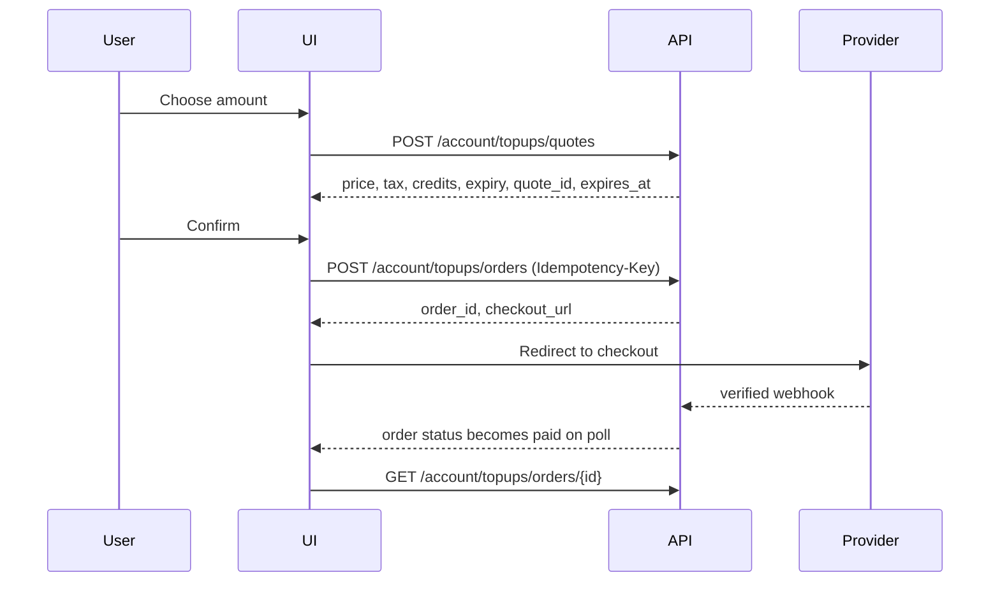

# Subscription Visibility — Customer Dashboard Integration Guide

How end users (Customer Account Admin and Customer Viewer) see their plan,
credits, billing and top-ups inside the product dashboard. Backend contracts are
in `SUBSCRIPTION_PLAN_API_IMPLEMENTATION.md`.

All endpoints are **organization-scoped by the JWT** — the frontend never sends
an `organization_id`; the API derives it from the token and returns `403
TENANT_MISMATCH` if a path/body tries to override it.

| Item              | Value                                                      |
| ----------------- | ---------------------------------------------------------- |
| Base URL          | Core Service `http://localhost:8001/api/v1` (prod gateway) |
| Auth              | `Authorization: Bearer <access_token>`                     |
| Read permission   | `subscription.read` (Account Admin + Viewer)               |
| Write permissions | `billing.manage`, `billing.topup` (Account Admin only)     |
| Decimals          | strings; render with the org currency                      |
| Times             | ISO-8601 UTC; render in the org's billing timezone         |

---

## 1. Routes and screens

```text
/dashboard                          → dashboard home (subscription + credits widgets)
/account/subscription               → plan, renewal, weight, payment status
/account/billing                    → invoices + receipts
/account/billing/invoices/:id       → invoice detail + download
/account/credits                    → balance, batches, expiry timeline, ledger
/account/credits/buy                → top-up quote + checkout
/account/reports                    → CSV export
```

Viewer sees everything read-only; hide _Buy credits_ and payment CTAs, or show
them disabled with "Ask your account admin".

---

## 2. Dashboard home widgets

Two widgets are enough for the landing page; everything else is one click away.

### 2.1 Subscription card

`GET /account/subscription`

```json
{
  "plan": { "code": "ENT-GROWTH", "name": "Enterprise Growth" },
  "status": "active",
  "billing_cadence": "annually",
  "current_period_start": "2026-11-01T00:00:00Z",
  "current_period_end": "2027-10-31T23:59:59Z",
  "renewal_date": "2027-11-01",
  "next_invoice_date": "2027-11-01",
  "id_weight": "0.500000",
  "included_credits_per_period": "120000.000000",
  "payment_status": "current",
  "grace_until": null,
  "can_top_up": true
}
```

Render:

| Field             | Display                                                            |
| ----------------- | ------------------------------------------------------------------ |
| `plan.name`       | Title; `plan.code` as secondary text                               |
| `status`          | Pill; map `overdue` → warning, `suspended`/`closed` → error        |
| `billing_cadence` | "Billed annually" / "Billed monthly" / "Billed quarterly"          |
| `renewal_date`    | "Renews 1 Nov 2027"; for `overdue`, replace with "Payment overdue" |
| `id_weight`       | "1 ID = 0.5 credits"                                               |
| `payment_status`  | `current` / `due` / `overdue` with link to `/account/billing`      |

Status-specific banners:

- `pending_activation_payment` → "Activate your account to start generating IDs"
  - payment CTA.
- `overdue` → banner with `grace_until`; keep credits visible.
- `suspended` → "Issuance paused"; top-up CTA hidden.
- `closed` → read-only history; contact support.

### 2.2 Credits widget

`GET /account/credits`

```json
{
  "available": "1950.000000",
  "reserved": "0.000000",
  "used_this_period": "250.000000",
  "expiring_30_days": "0.000000",
  "expiring_60_days": "0.000000",
  "expiring_90_days": "0.000000",
  "earliest_expiry": {
    "batch_id": "…",
    "expires_at": "2027-01-01T00:00:00Z",
    "quantity": "750.000000"
  },
  "id_weight": "0.500000",
  "estimated_ids_available": 3900,
  "as_of": "2026-10-18T10:00:00Z"
}
```

Render:

- Large number: **available** credits (2dp, full value in tooltip).
- Sub-line: "≈ 3,900 IDs at current weight" from `estimated_ids_available`
  (labelled as an estimate; never used for enforcement).
- Secondary: reserved now, used this period.
- Expiry strip: show the smallest non-zero bucket of
  `expiring_30/60/90_days`; if all zero, show the `earliest_expiry` date.
- CTA _Buy credits_ (hidden for Viewer or when `can_top_up === false`).

Never render a negative balance. If the API omits `earliest_expiry`, show "No
expiring credits".

---

## 3. Subscription screen

`/account/subscription` reuses `GET /account/subscription` plus
`GET /account/credits/expirations`:

```json
{
  "buckets": {
    "within_30_days": "0.000000",
    "within_60_days": "750.000000",
    "within_90_days": "750.000000"
  },
  "timeline": [
    {
      "batch_id": "…",
      "expires_at": "2027-01-01T00:00:00Z",
      "quantity": "750.000000",
      "source": "invoice_plan"
    }
  ]
}
```

Layout: plan summary card → "What's included" (credits per period, ID weight,
top-ups allowed) → expiry timeline → link to invoices.

Show the billing anchor/timezone only as a tooltip ("Period starts on day 1,
Africa/Lagos") to avoid confusing users in other timezones.

---

## 4. Credits screen

### 4.1 Batch history

`GET /account/credits/batches?page=1&page_size=20&status=active`

```json
{
  "items": [
    {
      "id": "…",
      "source_type": "invoice_plan",
      "source_ref": "INV-2026-000123",
      "granted": "1000.000000",
      "remaining": "750.000000",
      "issued_at": "2026-01-01T00:00:00Z",
      "expires_at": "2027-01-01T00:00:00Z",
      "status": "active"
    }
  ],
  "pagination": {
    "page": 1,
    "page_size": 20,
    "total_items": 2,
    "total_pages": 1
  }
}
```

Columns: Source (invoice/top-up/legacy/promo) · Granted · Remaining · Issued ·
Expires · Status. Sort default `expires_at ASC` (matches FEFO). Expired and
exhausted batches remain visible for audit; badge them but do not sum them.

### 4.2 Ledger

`GET /account/credits/ledger?page=1&page_size=20&type=consume&from=&to=`

Entry fields: `type`, `qty` (signed), `balance_after`, `reference_type`,
`reference_id`, `operation_id`, `occurred_at`, `reason`. Render `consume` as
negative and `grant` as positive; group by day; link `operation_id` to the QR
generation job screen when available.

Filters: date range, type, source batch. Export respects current filters via
`GET /account/reports/credits.csv?…`.

---

## 5. Billing screen

`GET /account/invoices?status=&page=1&page_size=20`

```json
{
  "items": [
    {
      "id": "…",
      "invoice_no": "INV-2026-000123",
      "invoice_type": "subscription",
      "posting_date": "2026-11-01T00:00:00Z",
      "due_date": "2026-11-15T00:00:00Z",
      "status": "paid",
      "subtotal": "12000.00",
      "tax_total": "900.00",
      "grand_total": "12900.00",
      "outstanding_amount": "0.00",
      "currency": "USD",
      "download_url": null
    }
  ]
}
```

- Status pills: `draft` (never shown to customers), `issued`, `partially_paid`,
  `paid`, `overdue`, `void`.
- _Download_ calls `GET /account/invoices/{id}/download` and follows the
  short-lived signed URL; do not cache URLs beyond the page session.
- Unpaid invoice → _Pay now_ button when the API returns a `payment_link`.

---

## 6. Buy credits flow



Rules:

- Quotes expire (typically 15 min). If `expires_at` passes, disable _Pay_ and
  re-quote silently; never send an expired `quote_id`.
- Show the credit expiry date from the quote **before** payment.
- The success redirect is informational only — poll
  `GET /account/topups/orders/{order_id}` (2 s interval, stop after 60 s) and
  only show "Credits added" when `status === "paid"`.
- Pending state copy: "Waiting for payment confirmation" with a _Refresh_ button.
- Failure state: "Payment failed — no credits were added", link back to quote.

---

## 7. Client-side display rules

1. **No client math on balances.** Show server `available`; `estimated_ids_available`
   is display-only.
2. Format credits with up to 2 dp, truncate (not round) for display; tooltip
   shows the exact 6dp value.
3. Never derive `available` by summing batch `remaining` in the client — batches
   and projection can diverge momentarily; trust `/account/credits`.
4. Show currency from the API, not a hardcoded symbol.
5. Handle `included_credits_per_period` = 0 (pay-as-you-go via top-ups).
6. Expiry copy: "Credits expire 12 months after they are issued."
7. Accessibility: status pills need text labels, not colour alone; the credits
   number is an `aria-live="polite"` region updated after refresh.

---

## 8. Refresh and caching

| Data                    | Strategy                                                            |
| ----------------------- | ------------------------------------------------------------------- |
| `/account/subscription` | Fetch on route entry; cache 5 min; invalidate after payment/top-up  |
| `/account/credits`      | Fetch on dashboard entry; poll every 60 s while the page is visible |
| Batches/ledger          | Fetch on demand, paginated; no background polling                   |
| Invoices                | Cache 2 min; refresh after returning from provider checkout         |
| Top-up order status     | Poll 2 s while `pending`, max 60 s                                  |

Use `document.visibilityState` to pause polling in background tabs. Abort
in-flight requests on unmount.

---

## 9. Error and gating UX

| HTTP / code                 | Where                   | UI behaviour                                                 |
| --------------------------- | ----------------------- | ------------------------------------------------------------ |
| `403 TENANT_MISMATCH`       | any                     | Generic "Access denied"; log out if persistent               |
| `402 INSUFFICIENT_CREDITS`  | generation entry points | Modal: available vs required, _Buy credits_ CTA              |
| `402 SUBSCRIPTION_INACTIVE` | any write               | Banner + link to billing; disable generate                   |
| `409 OPERATION_IN_PROGRESS` | retry of generation     | "Already in progress" — do not retry blindly                 |
| `410 RESERVATION_EXPIRED`   | async generation        | Restart flow; no double charge                               |
| `422 INVALID_QUOTE`         | top-up                  | Auto re-quote and show the new total                         |
| `5xx`                       | any                     | Inline retry; keep last good data visible with a stale stamp |

Initial load: skeletons, not spinners over empty cards. Partial failure: render
whichever widget loaded and a per-widget retry.

---

## 10. Acceptance checklist

- [ ] Dashboard shows plan, renewal date, ID weight and available credits.
- [ ] Expiry insight appears when credits expire within 90 days.
- [ ] Low/insufficient credit state routes to the top-up flow with an actionable CTA.
- [ ] Viewer role cannot see payment/top-up actions.
- [ ] Buy-credits flow shows the credit expiry date before payment and never
      grants on redirect.
- [ ] Totals reconcile with the invoice list and ledger export for the same period.
- [ ] All amounts use the API currency and string decimals.
- [ ] `pending_activation_payment`, `overdue` and `suspended` states are clearly
      distinguishable and none allow silent issuance.
- [ ] Empty states exist for: no plan assigned, no credits, no invoices, no
      ledger entries.
