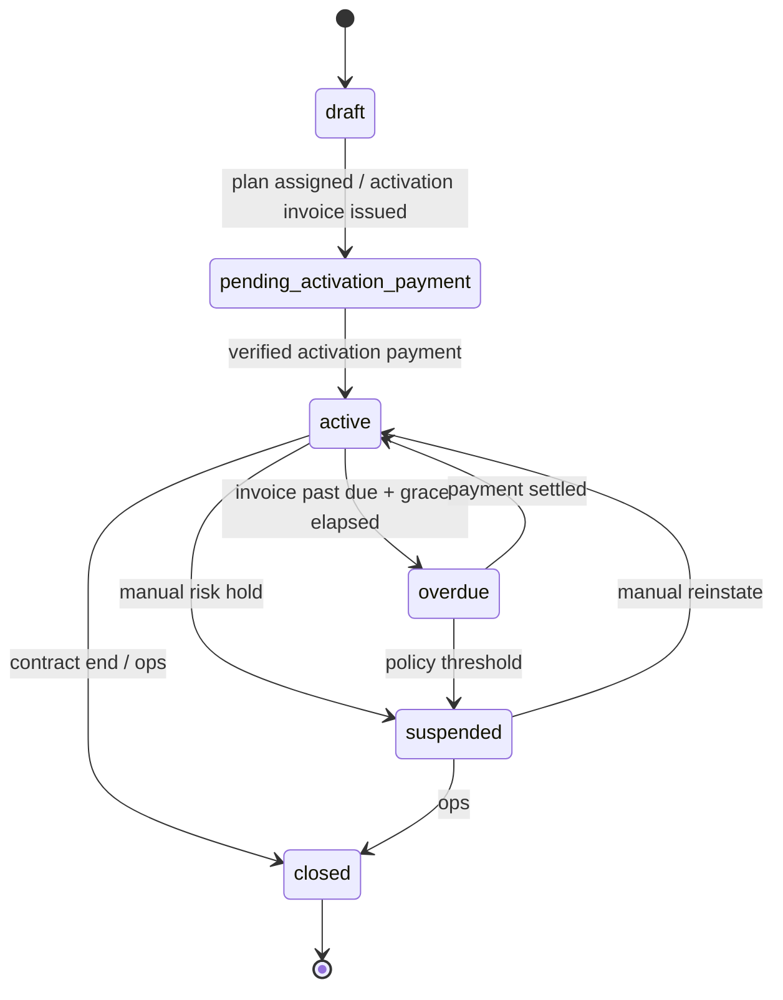
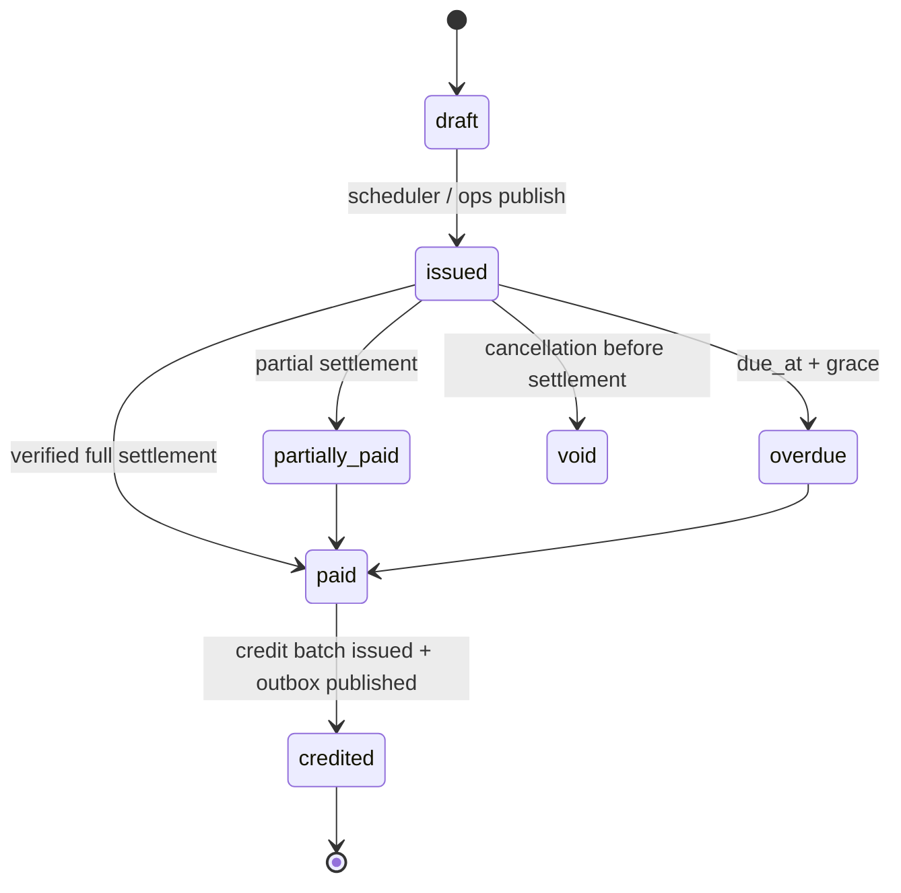

# Subscription Plans, Billing & Credits — API Implementation Guide

Companion to _Ciphercode Subscription, Billing & Credit Architecture v1.0_. This
document maps the functional spec onto **this repository** (FastAPI services),
states what already exists, what must be built, and gives implementation-ready
table definitions, endpoints, payloads and invariants.

| Service                      | Base URL (local)               | Owns                                          |
| ---------------------------- | ------------------------------ | --------------------------------------------- |
| Identity Service             | `http://localhost:8000/api/v1` | `organizations`, users, roles/permissions     |
| Core Service                 | `http://localhost:8001/api/v1` | invoices, payments, QR credits, QR generation |
| Worker / Identity Generation | internal network               | reserve → generate → commit credit operations |

**Terminology mapping** — the architecture spec says _tenant_; this codebase uses
**organization** (`organizations.id`, enforced as `organization_id` on every
child row). Read "tenant" as "organization" throughout.

---

## 1. What already exists (do not rebuild)

| Capability                          | Location                                                                 | Notes                                                                                                                                                                                        |
| ----------------------------------- | ------------------------------------------------------------------------ | -------------------------------------------------------------------------------------------------------------------------------------------------------------------------------------------- |
| Organization + billing fields       | `identity-service/app/models/organization.py`                            | `billing_status`, `billing_cycle`, `subscription_start_date`, `subscription_end_date`, `next_billing_date`, `max_users`, `max_credits`, `billing_contact_email`                              |
| Subscription/setup/overage invoices | `core-service/app/models/invoice.py`                                     | `invoice_type` ∈ `subscription`, `setup_fee`, `overage`; `billing_cycle`, `subscription_period_start/end`, `seat_count`, `credit_usage`                                                      |
| Admin invoice & billing ops         | `core-service/app/api/v1/endpoints/admin/billing.py`                     | `POST /admin/billing/subscription-invoice`, `/setup-fee-invoice`, `/overage-invoice`, `/addon-invoice`, `/credit-adjustment-invoice`, `GET /admin/billing/summary`, `/summary/{customer_id}` |
| QR credit balance (single bucket)   | `core-service/app/models/qr_credit.py`, `app/services/credit_service.py` | `qr_credit_balance`, `qr_credit_ledger`, `qr_credit_reservations`, `qr_credit_usage`; `SELECT … FOR UPDATE` reservation flow                                                                 |
| Org-facing credit read API          | `core-service/app/api/v1/endpoints/qr_credits.py`                        | `GET /qr-credits/balance`, `GET /qr-credits/ledger`, admin `GET/POST /qr-credits/organizations/{id}/…`                                                                                       |
| Permission helpers                  | `core-service/app/core/authorization.py`, `app/dependencies.py`          | `require_permission(...)`, `require_admin`; `system_admin.billing_read/create/update`                                                                                                        |

### 1.1 Gaps vs. the architecture spec

| Gap                                          | Impact                                              | Action                                                 |
| -------------------------------------------- | --------------------------------------------------- | ------------------------------------------------------ |
| No plan catalog / contract version entity    | Prices and ID weight only entered per invoice       | Add `subscription_plans`, `subscription_plan_versions` |
| No per-organization subscription lifecycle   | Status lives on `organizations.billing_status` only | Add `organization_subscriptions`                       |
| Credits are a single integer bucket          | No batch expiry, no FEFO, no weight                 | Add `credit_batches` + microcredit ledger              |
| No top-up checkout                           | Top-ups can only be admin-granted                   | Add `topup_quotes`, `topup_orders`                     |
| No payment webhook ingestion / dedupe        | Grants depend on manual invoice marking             | Add `billing_provider_events` + outbox                 |
| `qr_credit_balance` is not rebuildable       | Manual adjustments cannot be proven                 | Make it a projection over `credit_batches` + ledger    |
| No idempotency keys on mutating billing APIs | Retries can double-invoice/double-grant             | Require `Idempotency-Key`                              |

---

## 2. Credit representation

- Money: `NUMERIC(15,2)` (already used on `invoices`).
- Credits: **`NUMERIC(20,6)`** or integer **microcredits** (`1 credit = 1_000_000`).
  Use microcredits internally; expose decimal strings in JSON (never floats).
- `id_weight` is versioned and `NUMERIC(20,6)`; snapshot on every generation
  operation so historical debits never change.
- `debit = round_half_up(id_count × weight_snapshot × 1_000_000)` in microcredits.

Migration note: existing `qr_credit_balance.balance_credits` (integer) is
grandfathered into one synthetic batch per organization
(`source_type='legacy_balance'`, `source_id = organization_id`) at rollout time.

---

## 3. Target data model

All tables keep `organization_id` and are filtered by it in _every_ query.
DDL is written as SQLAlchemy-model intent, matching existing `app/models` style.

### 3.1 `subscription_plans`

```text
id                UUID PK
organization_id   UUID NULL       -- NULL = global catalog plan; set = tenant-specific package
code              VARCHAR(60)     -- unique per organization (or globally when NULL)
name              VARCHAR(200)
description       TEXT
currency          CHAR(3)
is_active         BOOLEAN default true
created_at, updated_at
UNIQUE (organization_id, code)
```

### 3.2 `subscription_plan_versions` (immutable once published)

```text
id                 UUID PK
plan_id            UUID FK subscription_plans
version            INTEGER
billing_cadence    VARCHAR(20)     -- monthly | quarterly | annually
base_price         NUMERIC(15,2)   -- recurring fee before tax
tax_rate           NUMERIC(7,4)
included_credits   NUMERIC(20,6)   -- granted per paid invoice
id_weight          NUMERIC(20,6)   -- credits per generated ID
topup_allowed      BOOLEAN default true
effective_from     TIMESTAMPTZ
effective_to       TIMESTAMPTZ NULL
status             VARCHAR(20)     -- draft | approved | published | retired
approved_by        UUID NULL
created_at
UNIQUE (plan_id, version)
CHECK (effective_to IS NULL OR effective_to > effective_from)
```

Rules:

- A published version is never edited; changes create a new version.
- Only one version per plan may be `published` for a given instant.
- Contracts on `organization_subscriptions` point at a version, not a plan.

### 3.3 `organization_subscriptions`

```text
id                    UUID PK
organization_id       UUID UNIQUE FK organizations
plan_id               UUID FK subscription_plans
plan_version_id       UUID FK subscription_plan_versions
status                VARCHAR(30)  -- draft|pending_activation_payment|active|overdue|suspended|closed
billing_cadence       VARCHAR(20)
billing_anchor_day    SMALLINT      -- 1..28 (clamp 29-31)
billing_timezone      VARCHAR(64)   -- IANA, e.g. Africa/Lagos
activation_fee        NUMERIC(15,2) default 0
activation_fee_status VARCHAR(20)   -- not_required|pending|paid
current_period_start  TIMESTAMPTZ
current_period_end    TIMESTAMPTZ
activated_at          TIMESTAMPTZ NULL
suspended_at          TIMESTAMPTZ NULL
closed_at             TIMESTAMPTZ NULL
created_at, updated_at
```

### 3.4 `credit_batches`

```text
id                UUID PK
organization_id   UUID
source_type       VARCHAR(30)   -- invoice_plan | topup | activation | legacy_balance | promo | adjustment
source_id         UUID          -- invoice.id / topup_orders.id / organization.id for legacy
granted_qty       NUMERIC(20,6) -- microcredits
consumed_qty      NUMERIC(20,6) default 0
expired_qty       NUMERIC(20,6) default 0
reversed_qty      NUMERIC(20,6) default 0
reserved_qty      NUMERIC(20,6) default 0
issued_at         TIMESTAMPTZ
expires_at        TIMESTAMPTZ   -- issued_at + 12 calendar months, same local time
status            VARCHAR(20)   -- active | exhausted | expired
UNIQUE (organization_id, source_type, source_id)
CHECK (granted_qty > 0)
CHECK (consumed_qty + expired_qty + reversed_qty + reserved_qty <= granted_qty)
INDEX (organization_id, status, expires_at)   -- FEFO
```

`available_qty = granted_qty - consumed_qty - reserved_qty - expired_qty - reversed_qty`

### 3.5 `credit_ledger` (append-only; mirrors existing `qr_credit_ledger` contract)

```text
id               UUID PK
organization_id  UUID
batch_id         UUID FK credit_batches
type             VARCHAR(20)   -- grant|consume|reserve|release|expire|adjust_positive|adjust_negative|reversal
qty              NUMERIC(20,6) -- signed
balance_after    NUMERIC(20,6)
operation_id     UUID NULL     -- generation_operations.id
reference_type   VARCHAR(30) NULL
reference_id     UUID NULL
idempotency_key  VARCHAR(120)  -- UNIQUE per organization
actor_id         UUID NULL
reason           TEXT NULL
occurred_at      TIMESTAMPTZ default now()
UNIQUE (organization_id, idempotency_key)
INDEX (organization_id, occurred_at)
```

### 3.6 `generation_operations`

```text
id                UUID PK
organization_id   UUID
operation_key     VARCHAR(120)   -- client-supplied idempotency key
id_count          INTEGER
id_weight         NUMERIC(20,6)  -- snapshot
debit_qty         NUMERIC(20,6)  -- total debit including weighting
status            VARCHAR(20)    -- reserved|committed|released|failed
reserved_until    TIMESTAMPTZ
generated_count   INTEGER default 0
created_at, updated_at
UNIQUE (organization_id, operation_key)
```

### 3.7 `topup_quotes` / `topup_orders`

```text
topup_quotes: id, organization_id, plan_version_id NULL, credits NUMERIC(20,6),
              amount NUMERIC(15,2), currency, tax_amount, expires_at, consumed_at
topup_orders: id, organization_id, quote_id, invoice_id, amount, credits,
              status (created|pending|paid|failed|cancelled), provider, provider_ref UNIQUE,
              idempotency_key, paid_at
```

### 3.8 `billing_provider_events` (webhook dedupe) and `outbox_events`

```text
billing_provider_events: id, organization_id NULL, provider VARCHAR(30),
                         provider_event_id VARCHAR(191) UNIQUE, event_type,
                         payload JSONB, signature_verified BOOLEAN,
                         processed_at TIMESTAMPTZ NULL, received_at
outbox_events: id, organization_id, event_type, payload JSONB, published_at NULL, attempts
```

---

## 4. State machines





Credit batch: `active → exhausted | expired`. Ledger rows are append-only; only
compensating `reversal` entries are allowed after the fact.

---

## 5. API surface

Conventions for every mutating endpoint:

- `Authorization: Bearer <JWT>`; service-to-service uses `X-Internal-Secret`
  (see `INTERNAL_SERVICE_SECRET_SETUP.md`) plus service identity.
- `Idempotency-Key: <uuid>` **required**; replay returns the original response
  with `Idempotency-Replayed: true`.
- `Accept: application/json`; all decimals returned as strings.
- Errors use `{ "detail": { "code": "...", "message": "...", "context": {...} } }`.

### 5.1 Admin — plan catalog

| Method | Path                                                                | Permission                    | Purpose                                                    |
| ------ | ------------------------------------------------------------------- | ----------------------------- | ---------------------------------------------------------- |
| GET    | `/admin/subscription-plans`                                         | `system_admin.billing_read`   | List plans (filter `active`, `organization_id`, `q`, page) |
| POST   | `/admin/subscription-plans`                                         | `system_admin.billing_create` | Create plan shell                                          |
| GET    | `/admin/subscription-plans/{plan_id}`                               | `system_admin.billing_read`   | Plan + all versions                                        |
| POST   | `/admin/subscription-plans/{plan_id}/versions`                      | `system_admin.billing_create` | Create draft version                                       |
| PATCH  | `/admin/subscription-plans/{plan_id}/versions/{version_id}`         | `system_admin.billing_update` | Edit **draft only**                                        |
| POST   | `/admin/subscription-plans/{plan_id}/versions/{version_id}/approve` | `system_admin.billing_update` | Record approver                                            |
| POST   | `/admin/subscription-plans/{plan_id}/versions/{version_id}/publish` | `system_admin.billing_update` | Set `effective_from`, publish                              |
| POST   | `/admin/subscription-plans/{plan_id}/versions/{version_id}/retire`  | `system_admin.billing_update` | Close `effective_to`                                       |

Create plan:

```http
POST /api/v1/admin/subscription-plans
Content-Type: application/json
Idempotency-Key: 5c1b…

{
  "code": "ENT-GROWTH",
  "name": "Enterprise Growth",
  "description": "Tenant-specific package",
  "currency": "USD",
  "organization_id": "b0e1…"
}
```

Create/publish version:

```json
{
  "billing_cadence": "annually",
  "base_price": "12000.00",
  "tax_rate": "7.5000",
  "included_credits": "120000.000000",
  "id_weight": "0.500000",
  "topup_allowed": true,
  "effective_from": "2026-11-01T00:00:00Z"
}
```

Errors: `409 PLAN_CODE_EXISTS`, `409 VERSION_NOT_DRAFT`,
`409 EFFECTIVE_RANGE_OVERLAP`, `422 ID_WEIGHT_MUST_BE_POSITIVE`.

### 5.2 Admin — tenant subscription lifecycle

| Method | Path                                                   | Permission                    | Purpose                                          |
| ------ | ------------------------------------------------------ | ----------------------------- | ------------------------------------------------ |
| GET    | `/admin/organizations/{org_id}/subscription`           | `system_admin.billing_read`   | Subscription + contract snapshot                 |
| POST   | `/admin/organizations/{org_id}/subscription`           | `system_admin.billing_create` | Create draft subscription from published version |
| POST   | `/admin/organizations/{org_id}/subscription/activate`  | `system_admin.billing_update` | Mark activation paid (verified payment only)     |
| PATCH  | `/admin/organizations/{org_id}/subscription`           | `system_admin.billing_update` | Change version (future-effective), anchor day    |
| POST   | `/admin/organizations/{org_id}/subscription/suspend`   | `system_admin.billing_update` | Suspend with reason                              |
| POST   | `/admin/organizations/{org_id}/subscription/reinstate` | `system_admin.billing_update` | Reinstate                                        |
| POST   | `/admin/organizations/{org_id}/subscription/close`     | `system_admin.billing_update` | Close                                            |
| GET    | `/admin/subscriptions/exposure`                        | `system_admin.billing_read`   | Cross-tenant credit exposure / expiry            |
| GET    | `/admin/subscriptions/reconciliation`                  | `system_admin.billing_read`   | Invoice vs payment vs batch discrepancies        |

`GET /admin/organizations/{org_id}/subscription`:

```json
{
  "organization_id": "b0e1…",
  "plan": { "id": "…", "code": "ENT-GROWTH", "name": "Enterprise Growth" },
  "plan_version": {
    "id": "…",
    "version": 3,
    "effective_from": "2026-11-01T00:00:00Z",
    "billing_cadence": "annually",
    "base_price": "12000.00",
    "currency": "USD",
    "included_credits": "120000.000000",
    "id_weight": "0.500000"
  },
  "status": "active",
  "billing_anchor_day": 1,
  "billing_timezone": "Africa/Lagos",
  "activation_fee": "2500.00",
  "activation_fee_status": "paid",
  "current_period_start": "2026-11-01T00:00:00Z",
  "current_period_end": "2027-10-31T23:59:59Z",
  "next_invoice_date": "2027-11-01",
  "activated_at": "2026-10-20T09:14:03Z"
}
```

### 5.3 Admin — credit adjustments

| Method | Path                                        | Permission                    | Purpose                                                      |
| ------ | ------------------------------------------- | ----------------------------- | ------------------------------------------------------------ |
| GET    | `/qr-credits/organizations/{org_id}`        | `require_admin`               | Existing balance projection                                  |
| GET    | `/qr-credits/organizations/{org_id}/ledger` | `require_admin`               | Existing ledger page                                         |
| POST   | `/admin/credits/adjustments`                | `system_admin.billing_update` | `adjust_positive` / `adjust_negative` with reason + approval |

Request (dual approval: `approval_id` required above threshold):

```json
{
  "organization_id": "b0e1…",
  "direction": "adjust_positive",
  "quantity": "500.000000",
  "expires_at": "2027-10-18T00:00:00Z",
  "reason": "Goodwill — Q3 outage",
  "approval_id": "3f0a…"
}
```

`adjust_negative` must never take an aggregate balance below zero
(`422 INSUFFICIENT_BALANCE`). Both directions write a ledger entry; adjustments
are never raw `UPDATE`s.

### 5.4 Customer account — read APIs

All require an org-scoped JWT. Read permission:
`subscription.read` (Account Admin and Viewer). Billing mutations require
`billing.manage` (Account Admin). Add both permission codes to the permission
catalog and seed them on the customer org roles.

| Method | Path                                      | Purpose                                                              |
| ------ | ----------------------------------------- | -------------------------------------------------------------------- |
| GET    | `/account/subscription`                   | Current plan, cadence, renewal, weight, status                       |
| GET    | `/account/credits`                        | Aggregate + reserved + expiring windows + earliest expiry            |
| GET    | `/account/credits/batches`                | Paginated batch history (`status`, `expiring_before`)                |
| GET    | `/account/credits/ledger`                 | Paginated ledger with filters (`type`, `from`, `to`, `operation_id`) |
| GET    | `/account/credits/expirations`            | Buckets: 30 / 60 / 90 days                                           |
| GET    | `/account/invoices`                       | Paginated invoice history                                            |
| GET    | `/account/invoices/{invoice_id}/download` | Short-lived signed URL                                               |
| POST   | `/account/topups/quotes`                  | Server-side price/tax/credits/expiry quote                           |
| POST   | `/account/topups/orders`                  | Idempotent checkout order                                            |
| GET    | `/account/topups/orders/{order_id}`       | Payment status polling                                               |
| GET    | `/account/reports/credits.csv`            | CSV export with audit IDs                                            |

`GET /account/subscription`:

```json
{
  "organization_id": "b0e1…",
  "plan": { "code": "ENT-GROWTH", "name": "Enterprise Growth" },
  "status": "active",
  "billing_cadence": "annually",
  "current_period_start": "2026-11-01T00:00:00Z",
  "current_period_end": "2027-10-31T23:59:59Z",
  "renewal_date": "2027-11-01",
  "next_invoice_date": "2027-11-01",
  "id_weight": "0.500000",
  "included_credits_per_period": "120000.000000",
  "payment_status": "current",
  "grace_until": null,
  "can_top_up": true
}
```

`GET /account/credits`:

```json
{
  "available": "1950.000000",
  "reserved": "0.000000",
  "used_this_period": "250.000000",
  "expiring_30_days": "0.000000",
  "expiring_60_days": "0.000000",
  "expiring_90_days": "0.000000",
  "earliest_expiry": {
    "batch_id": "…",
    "expires_at": "2027-01-01T00:00:00Z",
    "quantity": "750.000000"
  },
  "id_weight": "0.500000",
  "estimated_ids_available": 3900,
  "as_of": "2026-10-18T10:00:00Z"
}
```

`estimated_ids_available = floor(available ÷ id_weight)` — display-only; the
authoritative check happens at generation time.

Top-up quote:

```http
POST /api/v1/account/topups/quotes
{ "credits": "5000.000000" }
```

```json
{
  "quote_id": "…",
  "credits": "5000.000000",
  "subtotal": "250.00",
  "tax_amount": "18.75",
  "total": "268.75",
  "currency": "USD",
  "expires_at": "2026-10-18T10:15:00Z",
  "credit_expires_at": "2027-10-18T10:00:00Z"
}
```

Order creation (`Idempotency-Key` required) returns
`{ "order_id", "status": "pending", "checkout_url" }`; credits are granted only
from a verified provider event, never from the redirect.

### 5.5 Internal — generation credit operations

Callers: identity generation service / QR worker.

| Method | Path                        | Purpose                                      |
| ------ | --------------------------- | -------------------------------------------- |
| POST   | `/internal/credits/reserve` | Hold weighted quantity for an operation      |
| POST   | `/internal/credits/commit`  | Finalize generated IDs and debit             |
| POST   | `/internal/credits/release` | Release a failed/partial reservation         |
| POST   | `/internal/credits/rate`    | Quote debit for `id_count` at current weight |

Reserve:

```json
{
  "organization_id": "b0e1…",
  "operation_key": "gen-2026-10-18-0001",
  "id_count": 100
}
```

Response:

```json
{
  "operation_id": "…",
  "operation_key": "gen-2026-10-18-0001",
  "id_weight": "0.500000",
  "debit": "50.000000",
  "reserved_until": "2026-10-18T10:15:00Z",
  "allocations": [
    {
      "batch_id": "A",
      "quantity": "50.000000",
      "expires_at": "2027-01-01T00:00:00Z"
    }
  ]
}
```

Commit: `{ "operation_id", "generated_count" }` — must equal `id_count`;
partial generation uses `release` for the remainder and `commit` for generated
rows. Repeating `commit` with the same body returns the original result.

Release: `{ "operation_id", "reason" }` — idempotent; releases only still-held
reservation quantity.

Errors: `402 INSUFFICIENT_CREDITS`, `409 OPERATION_ALREADY_COMMITTED`,
`409 OPERATION_KEY_CONFLICT`, `410 RESERVATION_EXPIRED`,
`422 NO_ACTIVE_SUBSCRIPTION`, `422 ORGANIZATION_SUSPENDED`.

### 5.6 Webhooks

| Method | Path                            | Verification                                        |
| ------ | ------------------------------- | --------------------------------------------------- |
| POST   | `/payments/webhooks/{provider}` | HMAC signature + timestamp window + event-id dedupe |

Processing contract:

1. Verify signature (`HMAC-SHA256` over raw body) and timestamp skew (≤ 5 min).
2. Insert `billing_provider_events` on `provider_event_id`; duplicate → `200` no-op.
3. Re-fetch the transaction server-side from the provider (never trust the body
   alone); compare amount, currency, organization and `payment_ref`.
4. Inside one DB transaction: update `invoices` / `payments`, create the
   `credit_batches` row, write `grant` ledger entries, enqueue outbox events.
5. Mark `processed_at`; ack `200`. Unverifiable → `400`/`401` and alert.

---

## 6. FEFO consumption algorithm

```sql
-- inside one transaction, after locking the operation row
SELECT id, granted_qty - consumed_qty - reserved_qty - expired_qty - reversed_qty AS available
FROM credit_batches
WHERE organization_id = :org
  AND status = 'active'
  AND expires_at > now()
  AND granted_qty - consumed_qty - reserved_qty - expired_qty - reversed_qty > 0
ORDER BY expires_at ASC, issued_at ASC
FOR UPDATE SKIP LOCKED;
```

Allocate greedily across batches; if the sum is below the required debit, abort
with `INSUFFICIENT_CREDITS` and leave every row untouched. Weight and contract
version are snapshotted at reserve time.

Concurrency:

- `SELECT … FOR UPDATE` on `credit_batches` (or `SERIALIZABLE`) — never
  read-modify-write a balance row without a lock.
- Expiry job locks batches then writes `expire` entries for
  `available_qty` at `expires_at`; a consume that already locked the batch wins
  and the expiry sees the reduced remainder.
- `qr_credit_balance` becomes a read projection; rebuild it by summing batches
  and ledger, never by ad-hoc increments (a `rebuild_credit_balance` management
  command must exist).

---

## 7. Recurring invoice job

`billing_invoice_scheduler` (worker):

1. Find subscriptions where `next_invoice_date <= today` in `billing_timezone`.
2. Insert `invoices(invoice_type='subscription', organization_id, subscription_period_start/end, billing_cycle, status='draft')`
   guarded by `UNIQUE (organization_id, invoice_type, subscription_period_start)`
   — the DB unique constraint is the duplicate guard, not application checks.
3. Snapshot price/tax/weight from the version; issue; notify; advance
   `next_invoice_date`.
4. On verified payment: one `credit_batches` row per
   `(organization_id, 'invoice_plan', invoice.id)`; reuse the unique constraint
   so replayed webhooks cannot double-grant.

Annual policy: default `annual_release_policy='monthly_tranches'` — 12 equal
batch grants released on the monthly anniversary of `activated_at`; set
`'upfront'` per contract only if finance approves. Store the choice on
`organization_subscriptions`. _(DECISION REQUIRED — see §12.)_

---

## 8. Error codes

| HTTP | Code                     | Meaning                               |
| ---- | ------------------------ | ------------------------------------- |
| 400  | `INVALID_QUOTE`          | Quote expired / already consumed      |
| 401  | `SIGNATURE_INVALID`      | Webhook signature mismatch            |
| 402  | `INSUFFICIENT_CREDITS`   | Debit exceeds available               |
| 402  | `SUBSCRIPTION_INACTIVE`  | Org not active / suspended            |
| 403  | `TENANT_MISMATCH`        | Path org ≠ token org (never 404-leak) |
| 404  | `PLAN_NOT_FOUND`         | Unknown plan/version                  |
| 409  | `IDEMPOTENCY_CONFLICT`   | Same key, different payload           |
| 409  | `VERSION_NOT_DRAFT`      | Edit/publish a non-draft version      |
| 409  | `OPERATION_IN_PROGRESS`  | Reservation still held                |
| 422  | `ID_WEIGHT_INVALID`      | Weight ≤ 0 or > configured max        |
| 422  | `INVOICE_TOTAL_MISMATCH` | Provider amount ≠ invoice total       |

---

## 9. Permissions to add

| Code                                                 | Role bundle                             |
| ---------------------------------------------------- | --------------------------------------- |
| `subscription.read`                                  | Customer Account Admin, Customer Viewer |
| `billing.manage`                                     | Customer Account Admin                  |
| `billing.topup`                                      | Customer Account Admin                  |
| `system_admin.subscription_plans_read/create/update` | Ciphercode ops admin                    |
| `system_admin.credits_adjust`                        | Finance Admin (with approval)           |

Register in `core-service/app/core/authorization.py` and in the identity-service
permission seed; keep naming consistent with the existing
`system_admin.billing_*` codes.

---

## 10. Implementation order

1. **Migration**: `subscription_plans`, `subscription_plan_versions`,
   `organization_subscriptions`, `credit_batches`, `credit_ledger`,
   `generation_operations`, `topup_quotes`, `topup_orders`,
   `billing_provider_events`, `outbox_events` + unique constraints/indexes.
2. **Backfill**: legacy `qr_credit_balance` → one batch per org; write a
   `legacy_balance` grant entry; freeze direct balance writes.
3. **Repositories** (`subscription_plan_repository`,
   `subscription_repository`, `credit_ledger_repository`) with
   `with_for_update()` variants, mirroring `credit_repository.py`.
4. **Services**: `subscription_plan_service`, `subscription_service`,
   `credit_engine_service`, `topup_service`, `billing_webhook_service`.
5. **Admin routes** under `app/api/v1/endpoints/admin/subscription*.py`,
   registered in `admin/__init__.py`.
6. **Account routes** `app/api/v1/endpoints/account_billing.py`, registered in
   `app/api/v1/router.py` with prefix `/account`.
7. **Internal routes** with `X-Internal-Secret`, reuse existing internal patterns.
8. **Worker jobs**: invoice scheduler, expiry job, reservation sweeper, outbox
   publisher, reconciliation.
9. OpenAPI snapshot + Postman collection update.

Backward compatibility: keep `GET /qr-credits/balance` and `/ledger` returning
the same shape (now projected from batches), and keep
`/admin/billing/subscription-invoice` working for ad-hoc invoices until Phase 3.

---

## 11. Acceptance-test mapping

| ID  | Where it is enforced                                                     |
| --- | ------------------------------------------------------------------------ |
| T01 | `organization_subscriptions` status transition + activation webhook test |
| T02 | `billing_provider_events.provider_event_id` unique + batch unique key    |
| T03 | `UNIQUE(organization_id, invoice_type, subscription_period_start)`       |
| T04 | annual release policy unit test                                          |
| T05 | `credit_engine.weighted_debit` parametrized (0.5/1/2)                    |
| T06 | concurrent reserve test (`FOR UPDATE`, expect no negative availability)  |
| T07 | FEFO order test with two batches                                         |
| T08 | expiry clamp test (leap year, month-end)                                 |
| T09 | expiry job test: A expires, B untouched                                  |
| T10 | top-up webhook test: one batch, failure grants none                      |
| T11 | weight snapshot test: historical debit unchanged                         |
| T12 | reserve → release/commit idempotency test                                |
| T13 | tenant scoping tests on every account/admin read                         |
| T14 | forged webhook / amount mismatch test                                    |
| T15 | adjustment approval + compensating entry test                            |
| T16 | reconciliation: sum(batches) == projection == ledger balance_after       |
| T17 | overdue/suspension grace policy test                                     |
| T18 | outbox replay after crash issues exactly one grant                       |

Suggested locations: `core-service/tests/services/test_subscription_*.py`,
`core-service/tests/api/test_account_billing.py`,
`core-service/tests/api/test_admin_billing.py`.

---

## 12. Open decisions blocking production

1. Activation fee: separate invoice or rolled into first recurring invoice?
2. Annual prepaid release: upfront vs. monthly tranches (default above:
   tranches).
3. Expiry convention: 12 calendar months, same local time, clamp end-of-month —
   confirm timezone source (org vs. subscription).
4. Grace period length and whether valid paid credits stay usable while overdue.
5. Weight granularity: tenant/plan-level (implemented) vs. per ID type.
6. Credit transfer: disabled by default; confirm no customer-visible transfer UI.
7. Tax engine ownership: invoice-level rate on the plan version until finance
   specifies a tax service.

---

## 13. Implementation status — Phase 1 (implemented)

Phase 1 foundations from §10 are implemented and running:

| Layer        | File                                                                                                                         |
| ------------ | ---------------------------------------------------------------------------------------------------------------------------- |
| Models       | `core-service/app/models/subscription.py`                                                                                    |
| Migration    | `core-service/alembic/versions/136_subscription_billing.py`                                                                  |
| Schemas      | `core-service/app/schemas/subscription.py`                                                                                   |
| Repositories | `app/repositories/subscription_repository.py`, `app/repositories/credit_ledger_repository.py`                                |
| Services     | `app/services/subscription_plan_service.py`, `app/services/subscription_service.py`, `app/services/credit_engine_service.py` |
| Admin API    | `app/api/v1/endpoints/admin/subscriptions.py` (mounted at `/api/v1/admin`)                                                   |
| Account API  | `app/api/v1/endpoints/account_billing.py` (mounted at `/api/v1/account`)                                                     |
| Internal API | `app/api/v1/endpoints/internal_credits.py` (mounted at `/api/v1/internal/credits`, `X-Internal-Secret`)                      |

Live endpoints (all verified registered at app startup):

- `GET|POST /admin/subscription-plans`, `GET /admin/subscription-plans/{id}`
- `POST|PATCH /admin/subscription-plans/{id}/versions[/{version_id}]`
- `POST …/versions/{version_id}/approve|publish|retire`
- `GET|POST|PATCH /admin/organizations/{org_id}/subscription`
- `POST …/subscription/activate|suspend|reinstate|close`
- `POST /admin/credits/adjustments`, `GET /admin/subscriptions/exposure|reconciliation`
- `GET /account/subscription|credits|credits/batches|credits/ledger|credits/expirations|invoices`
- `POST /account/topups/quotes|orders`, `GET /account/topups/orders/{id}`
- `GET /account/reports/credits.csv`
- `POST /internal/credits/rate|reserve|commit|release|expire`

Behavioral notes:

- Credits are stored as `NUMERIC(20,6)`; everything is FEFO and append-only.
  `credit_ledger.qty` is the signed change in _availability_; `consume` rows are
  written with `qty = 0` because reserved → consumed does not change
  availability (use `generation_operations.debit_qty` for usage reporting).
- Account reads accept `subscription.read` **or** the existing
  `qr_product.read` so org roles work before the new permission codes are
  seeded; top-ups accept `billing.topup`, `billing.manage`, or
  `qr_product.manage`. Seed the dedicated codes in the identity permission
  catalog as a follow-up.
- `mark_topup_paid()` exists in `CreditEngineService` for the future verified
  webhook; the HTTP webhook route is intentionally not exposed yet.

Remaining Phase 2/3 work: provider webhook endpoint + `billing_provider_events`
ingestion, recurring invoice scheduler worker, credit-expiry cron wiring,
`GET /account/invoices/{id}/download` signed URLs, and the billing React screens
described in the two UI integration guides.
